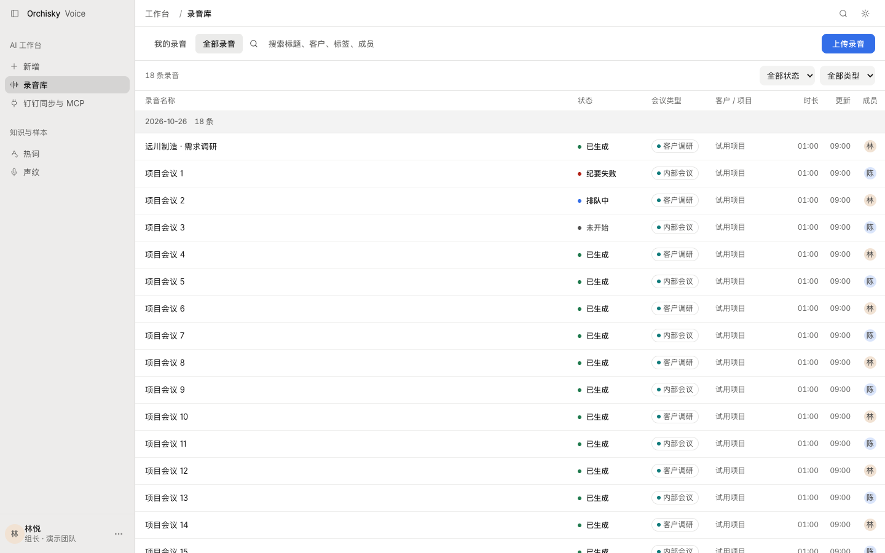
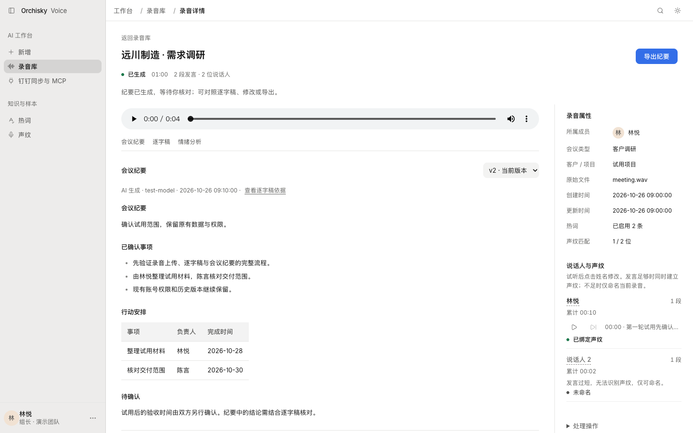
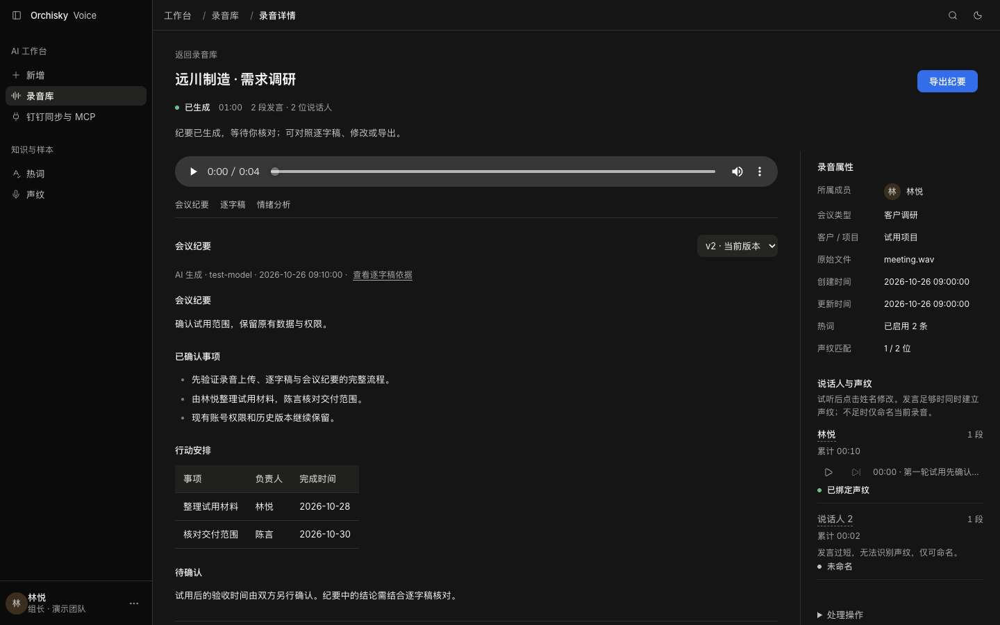
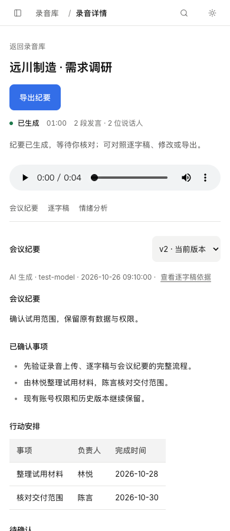

# Orchisky Voice 网页版 · Aham UI 9.1 精修

当前主线对应本地多用户网页版，沿用 aham-ui 9.1.0（`464daa3`）的内容优先、单主操作、安静层级与可核对的 AI 输出设计。已将网页版与旧桌面版的历史归并，应用代码以经过验证的 `82df197` 为准；旧桌面版保留在 [archive/desktop-main-20261026](https://github.com/Aham-AIAPP/aham-voice/tree/archive/desktop-main-20261026)。部署时使用当前主线的配套代码。

## 本轮调整

- 录音库补充列名、日期分组数量和空值文案，保留桌面 44px 行高；键盘聚焦时整行可辨认。
- 纪要标题、来源、正文与修改入口统一对齐；规范段落、列表、表格和章节间距，正文最大宽度 640px。
- 阅读长逐字稿时，播放器与章节入口保持可见。点击时间戳定位并播放，对应发言显示当前位置；播放不自动滚动页面。
- 改写预览同时展示修改要求、生成内容及原版对照，仍须确认后生成新版本。
- 详情页保留录音库导航选中态；统一“说话人”和“所属成员”用词；手机操作保持至少 44px 点击高度。

本轮不修改 API 字段、数据库结构或 MCP 契约。此前的改写草稿/确认接口、纪要来源字段、OAuth 权限与原业务流程保持兼容。

## 界面

以下截图来自实际 React 页面，全部使用虚构测试数据。

## 验证

浏览器测试覆盖 1440、1024、390、320px 与深浅主题，及上传、筛选返回、播放定位、历史导出、改写预览/确认、说话人命名、权限与管理页面。新增长逐字稿用例验证章节跳转不被固定播放器遮挡、时间戳定位与播放位置同步。测试使用隔离接口及合成音频，不改动正式录音。

运行命令和现有全仓 lint 限制见 [前端说明](../frontend-src/README.md)。

## 部署

`frontend/dist` 包含与源码一致的预构建资源。首次接入此分支必须同时部署配套后端与 MCP 服务；已部署上一版 Aham UI 9.1 网页版的环境，本轮仅需更新前端，无需重启转写任务或迁移数据。更新前保留旧资源和服务配置，切换后核对真实纪要、音频播放、导出和 MCP 读取。
